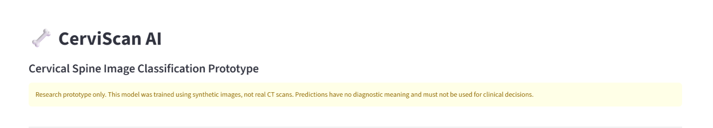
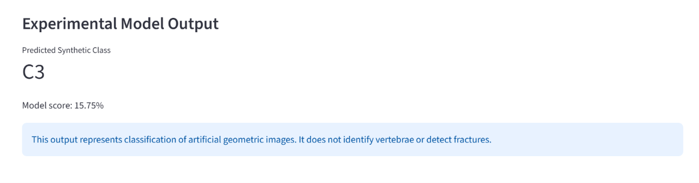

# 🦴 CerviScan AI – Cervical Spine Image Classification Prototype

## 📌 Project Overview

CerviScan AI is an experimental Machine Learning-based web application designed for cervical spine image classification.

The application uses a Convolutional Neural Network (CNN) model built with TensorFlow and provides an interactive interface using Streamlit. Users can upload an image and view the model's predicted synthetic class (C1–C7), along with the corresponding class scores.

This project demonstrates the application of image preprocessing, deep learning, and web-based image classification.

**Important:** This is a research prototype trained using synthetic geometric images, not real CT scans. Its predictions have no diagnostic meaning and must not be used for medical decisions.

---

## 🎯 Project Objectives

- Develop an image classification prototype for seven cervical vertebra classes (C1–C7).
- Apply image preprocessing techniques to prepare input images.
- Build a CNN model using TensorFlow and Keras.
- Create a user-friendly web application using Streamlit.
- Display predicted classes and model confidence scores.
- Evaluate model performance using classification metrics and visualizations.

---

## ✨ Features

- **Image Upload:** Upload an image through the Streamlit interface.
- **Image Preprocessing:** Convert images to grayscale, resize them to 224 × 224 pixels, and normalize pixel values.
- **CNN Classification:** Use a trained CNN model to classify images into seven synthetic classes.
- **Prediction Output:** Display the predicted synthetic class.
- **Class Scores:** Display the model scores for C1, C2, C3, C4, C5, C6, and C7.
- **Model Evaluation:** Generate a confusion matrix and training performance visualization.
- **Interactive Interface:** Simple and user-friendly web application.

---

## 🛠️ Technologies Used

| Category | Technologies |
|---|---|
| Programming Language | Python |
| Deep Learning | TensorFlow, Keras |
| Machine Learning | Scikit-learn |
| Image Processing | Pillow, NumPy |
| Data Visualization | Matplotlib |
| Web Framework | Streamlit |
| Model Storage | Keras (.keras), JSON |
| Development Environment | Visual Studio Code |

---

## 🧠 Model Information

The project uses a Convolutional Neural Network (CNN) for image classification.

**Model Details:**
- Model Architecture: Convolutional Neural Network
- Framework: TensorFlow / Keras
- Input Image Size: 224 × 224
- Image Format: Grayscale
- Number of Classes: 7
- Classes: C1, C2, C3, C4, C5, C6, C7
- Output Layer: Softmax Classification

The model generates class scores for the seven synthetic categories and displays the highest-scoring class as the prediction.

---

## 📂 Project Structure

```text
CerviScan_AI/
│
├── app.py
├── preprocessing.py
├── train_model.py
├── check_dataset.py
├── dataset_analysis.py
├── dataset_visualization.py
│
├── models/
│   ├── best_model.keras
│   ├── cerviscan_cnn.keras
│   └── class_names.json
│
├── outputs/
│   ├── synthetic/
│   └── preprocessed/
│       ├── X_train.npy
│       ├── X_test.npy
│       ├── y_train.npy
│       └── y_test.npy
│
├── results/
│   ├── confusion_matrix.png
│   ├── training_performance.png
│   └── evaluation_results.json
│
├── Screenshots/
│   ├── cerviscan_ai_homepage.png
│   ├── experimental_model_output.png
│   └── Glowing Cervical Spine Anatomy Diagram.png
│
├── requirements.txt
└── README.md
```

---

## 🚀 Installation and Setup

### 1. Clone the Repository

```bash
git clone https://github.com/NavyaRocky02/CerviScan-AI.git
```

### 2. Navigate to the Project Folder

```bash
cd CerviScan-AI
```

### 3. Create a Virtual Environment

```bash
python -m venv venv
```

### 4. Activate the Virtual Environment

For Windows:

```bash
venv\Scripts\activate
```

### 5. Install Required Libraries

```bash
pip install -r requirements.txt
```

### 6. Run the Application

```bash
streamlit run app.py
```

The application will open in your browser at:

```text
http://localhost:8501
```

---

## 📸 Screenshots

### 1. CerviScan AI Homepage



### 2. Experimental Model Output



### 3. Cervical Spine Anatomy Diagram


---

## 📊 Model Evaluation

The project includes evaluation outputs to examine the CNN model's performance.

- Confusion Matrix
- Training Performance Graph
- Evaluation Results

These outputs are stored in the `results/` directory.

**Note:** The model is experimental and currently has limited classification performance. The displayed model score is a prediction score, not a measure of overall model accuracy.

---

## ⚠️ Limitations and Disclaimer

- The model was trained using synthetic geometric images.
- It was not trained or validated using real cervical spine CT scans.
- The classification output does not identify actual vertebrae in medical images.
- It does not detect fractures, abnormalities, or diseases.
- The model is not clinically validated.
- Predictions must not be used for diagnosis or treatment decisions.

---

## 🔮 Future Enhancements

- Train and evaluate using suitable real-world, professionally annotated cervical spine imaging datasets.
- Improve image classification performance.
- Explore advanced CNN architectures and transfer learning.
- Expand model evaluation and validation.
- Improve the user interface and prediction visualization.

---

## 👩‍💻 Author

**Navya Sree Challa**

GitHub: [NavyaRocky02](https://github.com/NavyaRocky02)

Project Repository: [CerviScan AI](https://github.com/NavyaRocky02/CerviScan-AI)

---

## 📄 License

This project is developed for academic and educational research purposes.
